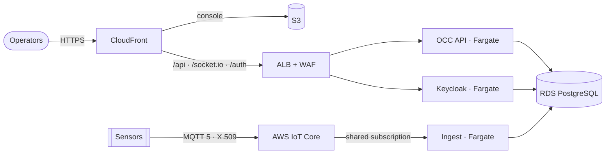

# Platform on AWS

[](https://github.com/truongtankhanh/platform-aws/actions/workflows/ci.yml)


AWS infrastructure, as TypeScript CDK, for the campus operations platform:
[ops-command-center](https://github.com/truongtankhanh/ops-command-center) (live incidents, map,
cameras) and [iot-telemetry-pipeline](https://github.com/truongtankhanh/iot-telemetry-pipeline)
(sensor data and alerts) on ECS Fargate, RDS PostgreSQL, CloudFront and AWS IoT Core — the cloud
counterpart of their single-host Compose deployment.



## Highlights

- **Five stacks per stage**, split by blast radius — registry, network, data, command center,
  telemetry — from one typed stage configuration. Site-only values (domain, certificates, camera
  relay) live outside the repository, and a production synth refuses to run without them.
- **Security checked on every synth.** `cdk-nag`'s AWS Solutions rules run in CI; each accepted
  finding is acknowledged on the exact resource that raised it, with its reason
  ([`lib/nag.ts`](lib/nag.ts)). A new finding fails the build, and a test proves it does.
- **Least privilege you can read in the tests.** Only this CloudFront distribution reaches the load balancer (its address ranges plus a secret origin header), which forwards an allowlist of paths; the database accepts only named security groups; the ingest service may subscribe to
  exactly one shared MQTT filter; a device may publish only to its own topic, as itself; every
  secret comes from Secrets Manager and no environment variable holds one.
- **No private key in CloudFormation.** IoT client certificates are created by a custom resource
  that writes the key straight to Secrets Manager.
- **One database per system on one instance** — logins and databases created by an idempotent
  custom resource, tested against a real PostgreSQL in CI, including that one system cannot open
  another's database.
- **One public origin**, as on premises: the console, API and Keycloak share a CloudFront domain,
  so the services run unchanged; WAF rate limits mirror the Compose stack's nginx limits, keyed on the address CloudFront saw rather than a header the client can forge.
- **Metrics without a metrics server**: an OpenTelemetry collector in each task turns the
  services' Prometheus endpoints into CloudWatch metrics; alarms cover 5xx, readiness, latency,
  database headroom and any lost telemetry message.
- **Deploys through GitHub OIDC** — no access keys — building the services' images at pinned
  refs, with circuit-breaker rollback on ECS.

## Status

Synthesised, security-checked and tested in CI for both stages. **Not deployed from this
repository**: no AWS account is attached to it, so the deploy workflow has never run, and
anything that only a live account can prove (IoT policy evaluation, Keycloak behind CloudFront,
the collector's metric conversion) is marked in the ADRs as designed rather than observed.

Telemetry alerts become incidents in the command center: the pipeline authenticates with client
credentials against the platform's Keycloak and calls the API over Service Connect. One
integration is deliberately not connected yet — the command center's own MQTT telemetry — with
the reason and the way forward in [ADR-0003](docs/adr/0003-aws-iot-core-as-the-broker.md#consequences).

## Repository

```
bin/platform.ts            CDK app: resolves the stage, builds the stacks
lib/config.ts              stage configuration (staging, production) and site values
lib/stacks/                registry · network · data · command-center · telemetry
lib/constructs/            metrics sidecar, database bootstrap, IoT certificate, prefix list, alarm topic
lib/nag.ts                 every accepted cdk-nag finding, with its reason
lambda/                    custom-resource handlers (database bootstrap, IoT certificate) + tests
images/                    platform layers: RDS CA for the services, Keycloak with the realm
scripts/prepare-realm.sh   the command center's realm without its demo users
test/                      assertions on the synthesised templates
docs/                      architecture, ADRs, runbook, handover guide
```

## Working on it

```bash
npm ci
npm test                    # template assertions + handler tests (set TEST_DATABASE_URL for the PostgreSQL one)
npm run synth               # staging, with cdk-nag
npm run synth:production    # production, with the example site values
```

Deploying needs an account, a deploy role and per-stage settings: [runbook](docs/runbook.md).
Taking over the repository, or making your first change: [handover guide](docs/handover.md).

## Decisions

[Architecture](docs/architecture.md) and eight ADRs:
[CDK in TypeScript](docs/adr/0001-cdk-in-typescript.md) ·
[one instance, one database per system](docs/adr/0002-one-instance-per-stage-one-database-per-system.md) ·
[AWS IoT Core](docs/adr/0003-aws-iot-core-as-the-broker.md) ·
[one origin through CloudFront](docs/adr/0004-one-public-origin-through-cloudfront.md) ·
[metrics through a collector](docs/adr/0005-metrics-through-an-in-task-collector.md) ·
[Keycloak on Fargate](docs/adr/0006-keycloak-on-fargate.md) ·
[production keeps its logs](docs/adr/0007-production-keeps-its-logs.md) ·
[database logs hold no bound values](docs/adr/0008-database-logs-hold-no-bound-values.md).
Platform-wide decisions are in
[architecture-decisions](https://github.com/truongtankhanh/architecture-decisions).

## License

[MIT](LICENSE) © Trương Tấn Khánh
