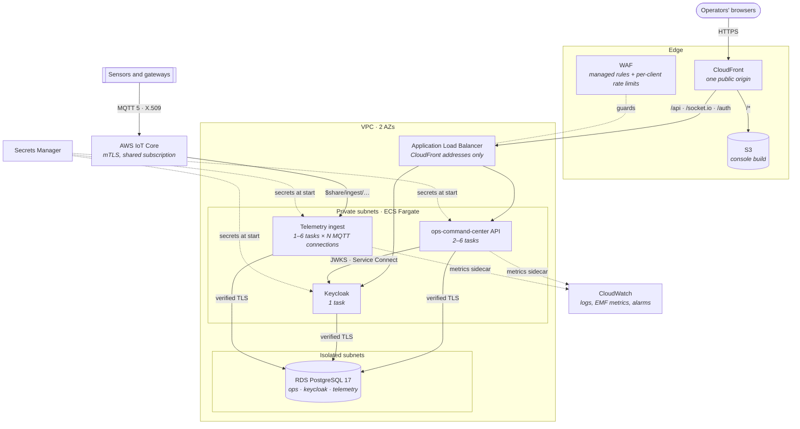

# Architecture

## Context

[ops-command-center](https://github.com/truongtankhanh/ops-command-center) and
[iot-telemetry-pipeline](https://github.com/truongtankhanh/iot-telemetry-pipeline) run on a single
host with Docker Compose at sites that keep everything on premises
([platform ADR-0007](https://github.com/truongtankhanh/architecture-decisions/blob/main/decisions/0007-compose-on-a-single-host-kubernetes-only-where-scale-needs-it.md)).
This repository is the other deployment target: AWS, for operators who allow cloud hosting. The
services are the same images with a thin platform layer; nothing in them changes for AWS except
what is listed under "What the systems had to gain".

## Containers and traffic

## Stacks

| Stack           | Holds                                                                                         | Changes      |
| --------------- | --------------------------------------------------------------------------------------------- | ------------ |
| `Registry`      | ECR repositories for the three images                                                         | rarely       |
| `Network`       | VPC (public / app / isolated tiers), flow logs, ECS cluster with Service Connect, alarm topic | rarely       |
| `Data`          | RDS instance, per-system logins, database bootstrap, database alarms                          | rarely       |
| `CommandCenter` | CloudFront, console bucket, ALB, WAF, Keycloak and API services, API alarms                   | each release |
| `Telemetry`     | IoT policies and the ingest certificate, ingest service, telemetry alarms                     | each release |

The split follows blast radius: a release touches the two service stacks; the data and network
stacks change only with a deliberate infrastructure change.

## Stage differences

|                | staging (demo)                                          | production                                                 |
| -------------- | ------------------------------------------------------- | ---------------------------------------------------------- |
| Domain         | CloudFront default, HTTP to origin from CloudFront only | custom domain, TLS 1.2+, HTTPS to origin                   |
| NAT gateways   | 1                                                       | 2 (one per AZ)                                             |
| Database       | `t4g.small`, single-AZ, 3-day backups                   | `m7g.large`, Multi-AZ, 14-day backups, deletion protection |
| API tasks      | 2–3                                                     | 2–6                                                        |
| Ingest         | 1–2 tasks × 2 connections                               | 2–6 tasks × 4 connections                                  |
| Demo behaviour | seeded data, simulator, mock cameras and telemetry      | off; cameras from the site's media relay                   |
| Log retention  | 14 days                                                 | 90 days                                                    |

## What the systems had to gain

- **iot-telemetry-pipeline** — client certificates from PEM secrets and several MQTT connections
  per replica (its ITP-19), because AWS IoT Core requires the first and caps delivery per
  connection (ADR-0003); and client credentials with an idempotency key per alert (ITP-20), which
  every deployment needs since the command center requires tokens.
- **ops-command-center** — no code: it already reads every setting from the environment, verifies
  the database certificate, runs as several replicas, and keeps its metrics port internal.
  Its realm gained the pipeline's client (OCC-29). One capability would let it do more here
  (ADR-0003): client certificates for its MQTT telemetry.

## Decisions

| ADR                                                                | Decision                                                                |
| ------------------------------------------------------------------ | ----------------------------------------------------------------------- |
| [0001](adr/0001-cdk-in-typescript.md)                              | AWS CDK in TypeScript; typed stage config; cdk-nag on every synth       |
| [0002](adr/0002-one-instance-per-stage-one-database-per-system.md) | One RDS instance per stage, one database and login per system           |
| [0003](adr/0003-aws-iot-core-as-the-broker.md)                     | AWS IoT Core as the broker; certificates; connections × 100 msg/s       |
| [0004](adr/0004-one-public-origin-through-cloudfront.md)           | One public origin through CloudFront; ALB only from CloudFront; WAF     |
| [0005](adr/0005-metrics-through-an-in-task-collector.md)           | Prometheus metrics into CloudWatch through an in-task collector         |
| [0006](adr/0006-keycloak-on-fargate.md)                            | Keycloak on Fargate as the identity provider, admin console not public  |
| [0007](adr/0007-production-keeps-its-logs.md)                      | Production keeps its log groups and access logs when a stack is deleted |
| [0008](adr/0008-database-logs-hold-no-bound-values.md)             | Slow-query logs keep the statement but not the values bound to it       |
